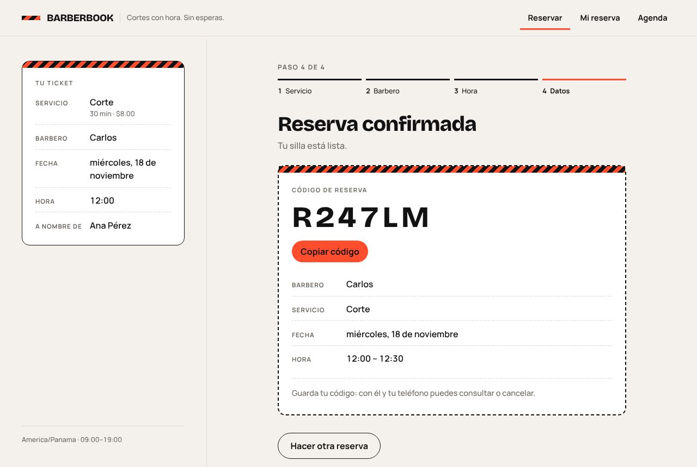
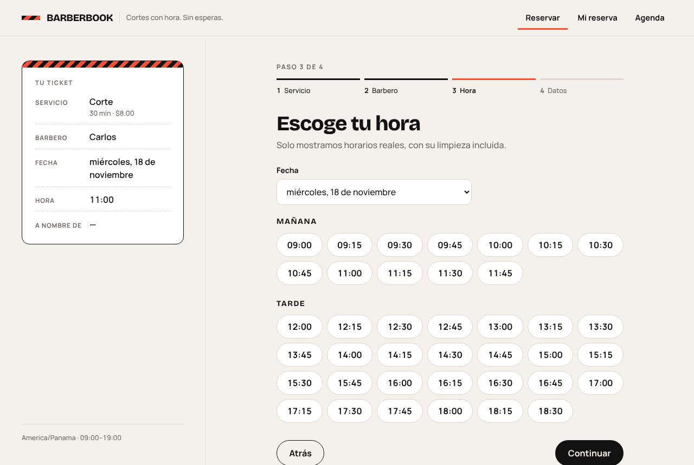
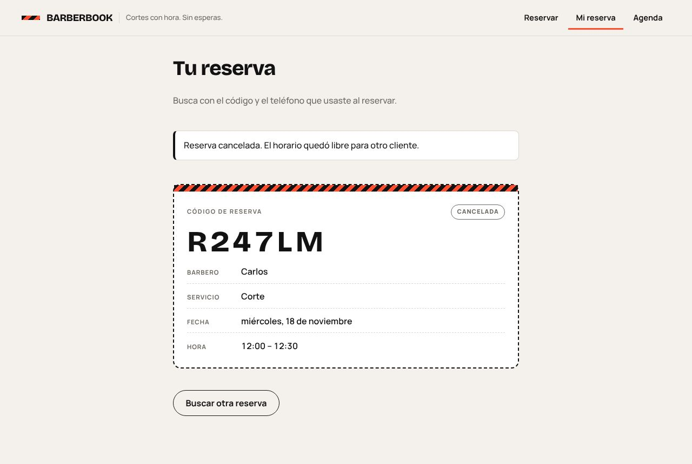
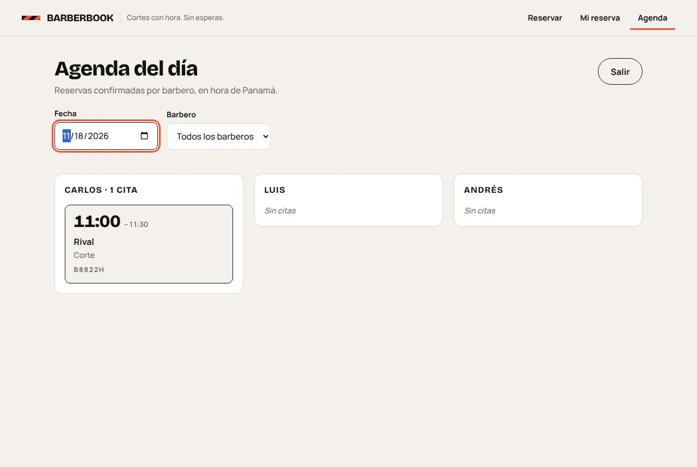

# 💈 BarberBook — Sistema de Reservas para Barbería

Proyecto 2 · Tópicos Especiales II · Prof. Regis Rivera · UTP

**Problema:** las citas se coordinan por WhatsApp → cruces de horario, esperas y espacios perdidos.
**Solución:** el cliente reserva solo, en 4 pasos, viendo únicamente horarios reales; la base de datos garantiza que **nunca** haya dos citas cruzadas del mismo barbero.



## Qué resuelve (outcomes)
| Outcome | Para quién | Cómo se ve en la app |
|---------|-----------|----------------------|
| **O1** Cero cruces | Barbería | Doble reserva imposible: validación en código **y** restricción en PostgreSQL, probada con 50 carreras simultáneas |
| **O2** Reserva autónoma | Cliente | Servicio → Barbero → Hora → Datos, sin hablar con nadie |
| **O3** Solo horarios reales | Cliente | Horario Mar–Sáb 09:00–19:00, grilla de 15 min, 10 min de limpieza entre citas |
| **O4** Agenda del día | Barbero / admin | Agenda por barbero protegida con clave |
| **O5** Liberar espacios | Cliente | Consultar y cancelar con código + teléfono (hasta 2 h antes) |

## Pantallas
| Reservar | Mi reserva | Agenda |
|----------|-----------|--------|
|  |  |  |

## Cómo levantarlo
Requisitos: **Docker Desktop** (o Docker + Compose). Todo corre en contenedores.

```bash
# 1. Configuración (una sola vez)
cp .env.example .env             # edita ADMIN_KEY con una clave larga y aleatoria

# 2. Levantar base de datos, API y frontend
docker compose up --build -d
```

Al arrancar, la API aplica sola las migraciones (tablas + barberos y servicios iniciales).

Abre **http://localhost:5173** (frontend) · API en **http://localhost:8000** (docs en `/docs`).
Para la pestaña **Agenda** usa la `ADMIN_KEY` de tu `.env`.

| Situación | Qué hacer |
|-----------|-----------|
| `docker compose` dice que falta `ADMIN_KEY` | Es a propósito: no arranca con una clave pública. Créala en `.env` (paso 1). |
| La app carga pero no muestra servicios/barberos | Revisa `docker compose logs api`: si una migración falló, la API no arranca. |
| Cambiaron dependencias (`pyproject.toml` o `package.json`) | `docker compose up --build -d -V` (el `-V` recrea el volumen de `node_modules`). |
| En `docker compose logs api` la migración falla por `no_double_booking` | Hay citas pegadas guardadas de antes de CR-01: `docker compose down -v` (borra los datos) y repite el paso 2. |
| Apagar todo | `docker compose down` (conserva los datos) · `docker compose down -v` (los borra) |

- **Hot reload:** el código de `src/backend` y `src/frontend` está montado en los contenedores; los cambios se ven sin reconstruir.
- **CORS:** la API solo acepta el origen del frontend (`http://localhost:5173`); otro origen se configura con `CORS_ORIGINS` en `.env` (`*` no se permite).

## Pruebas
```bash
# Backend (pytest) — ⚠️ los tests VACÍAN la tabla de reservas de la BD a la que apuntan.
# Para no perder los datos de la demo, usa una BD de prueba aparte:
docker compose exec db createdb -U barberbook barberbook_test
docker compose exec -e DB_URL=postgresql+psycopg://barberbook:barberbook@db:5432/barberbook_test api pytest -v
docker compose exec -e DB_URL=postgresql+psycopg://barberbook:barberbook@db:5432/barberbook_test api pytest --cov --cov-report=term

# Frontend (vitest)
cd src/frontend && npm install && npm test        # npm run coverage para la cobertura
```

| Indicador | Resultado |
|-----------|-----------|
| Backend | **166 tests** (unitarios, integración y concurrencia con PostgreSQL real) · cobertura **99 %** |
| Frontend | **12 tests** (reservar, consultar/cancelar, agenda) |
| Criterios de aceptación | **AC-01…AC-25: 25/25 ✅** → [matriz](docs/testing.md#matriz-de-evidencia-verify--converge) |
| CI | GitHub Actions: `backend-tests`, `frontend`, SonarCloud (Quality Gate) |

El test obligatorio de doble reserva es `test_double_booking_rejected` (AC-02) y su versión concurrente `test_concurrent_double_booking` (AC-06): 2 reservas simultáneas al mismo horario → exactamente **1×201 y 1×409**.

## Metodología: ODD → SDD → TDD
`Outcome → Requisito → Regla → Criterio → Test → Código`

1. **ODD (Outcome-Driven):** todo parte de un resultado para el usuario → [`specs/outcomes.md`](specs/outcomes.md).
2. **SDD (Spec-Driven):** la especificación es la fuente de verdad; la IA ejecuta; los tests verifican → [`specs/`](specs/).
   Ciclo: Constitution → Specify → Clarify → Plan → Tasks → Implement → Verify/Converge.
3. **TDD:** en cada tarea, primero un commit con los tests en 🔴, luego el código en 🟢 y después el refactor.

**Ejemplo de trazabilidad completa (la regla crítica):**

| Outcome | Requisito | Regla | Criterio | Tests | Código |
|---------|-----------|-------|----------|-------|--------|
| O1 Cero cruces | RF-06, RF-07, RNF-01 | BR-01 no doble reserva | AC-02, AC-03, AC-06 | `test_double_booking_rejected`, `test_partial_overlap_rejected`, `test_concurrent_double_booking` | `services/booking.py` (capa 1) + `no_double_booking` en PostgreSQL (capa 2) |

## Cambio de requerimiento (CR-01)
A mitad del proyecto se pidió **10 minutos de limpieza entre citas del mismo barbero**. Se siguió el ciclo completo:

| Paso | Evidencia |
|------|-----------|
| 1. Cambio solicitado | Issue [#21](https://github.com/GabiGonza14/TE2-proyecto2-barberia/issues/21) |
| 2–4. Spec, criterios y plan | PR [#23](https://github.com/GabiGonza14/TE2-proyecto2-barberia/pull/23): **BR-12**, **RF-15**, AC-04 y AC-11 modificados, AC-23…AC-25 nuevos, decisión **D9**, tarea **T13** |
| 5–6. Código y pruebas (TDD) | PR [#25](https://github.com/GabiGonza14/TE2-proyecto2-barberia/pull/25): columna `blocked_until` + migración que recrea `no_double_booking` |
| 7. Resultados | Matriz en [`docs/testing.md`](docs/testing.md) (todo ✅) · detalle en [`docs/decisions.md`](docs/decisions.md#cr-01--10-minutos-de-limpieza-entre-citas-del-mismo-barbero) |

## Documentación
| Qué | Dónde |
|-----|-------|
| Outcomes, requisitos, reglas, criterios | [`specs/`](specs/) |
| Arquitectura y Constitution | [`specs/architecture.md`](specs/architecture.md) |
| Contrato de la API | [`specs/api.md`](specs/api.md) |
| Decisiones (D1–D9) y CR-01 | [`docs/decisions.md`](docs/decisions.md) |
| Pruebas, evidencia y capturas | [`docs/testing.md`](docs/testing.md) |
| Registro de uso de IA | [`docs/ai-log.md`](docs/ai-log.md) |
| Guía del equipo | [`GUIA-DEL-EQUIPO.md`](GUIA-DEL-EQUIPO.md) |

## Stack
FastAPI · SQLAlchemy 2 · Alembic · PostgreSQL 16 · React 18 + Vite + TypeScript · pytest · vitest · Docker Compose · GitHub Actions · SonarCloud

## Equipo y roles (rotan por ciclo)
| Ciclo | Spec Lead | Dev Lead | QA/DevOps Lead |
|-------|-----------|----------|----------------|
| 1 · Base (T1–T4) | Gabriel González | Isalleth | Derlin |
| 2 · Reservar (T5–T7) | Isalleth | Derlin | Gabriel González |
| 3 · Gestionar (T8–T9) | Derlin | Gabriel González | Isalleth |
| 4 · UI y entrega (T10–T13) | Gabriel González | Isalleth | Derlin |

## Flujo Git
`main` protegida · ramas `feat/T<n>-nombre` · PR con revisión de alguien distinto al autor · squash merge · commits `tipo(alcance): mensaje #issue`
